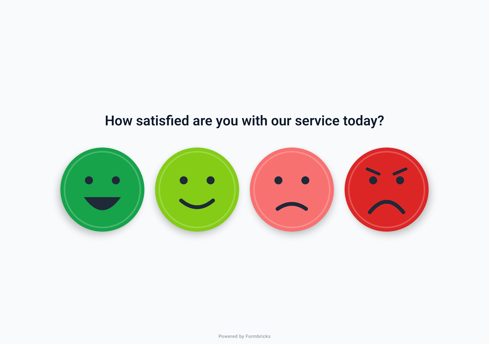
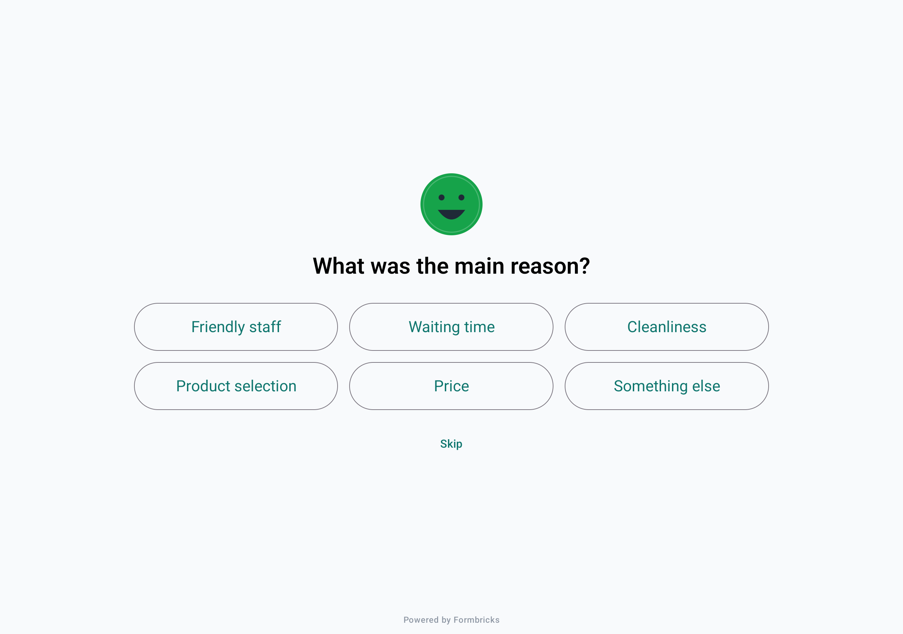
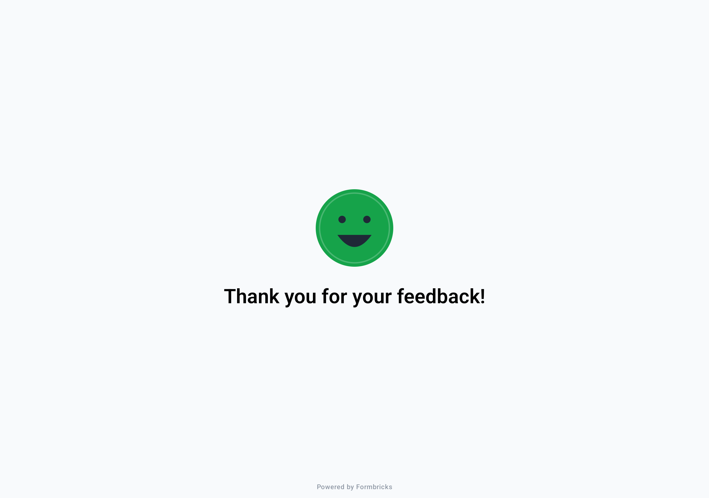
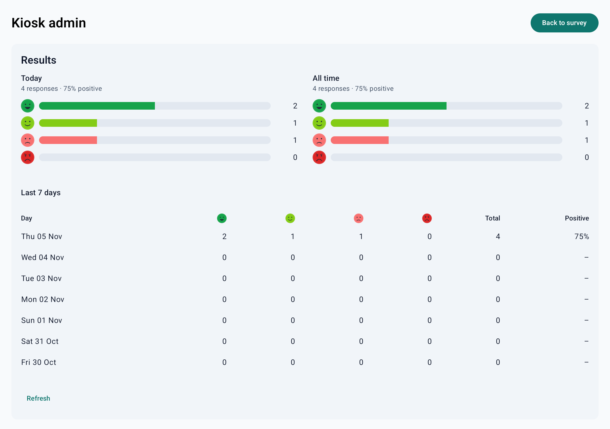
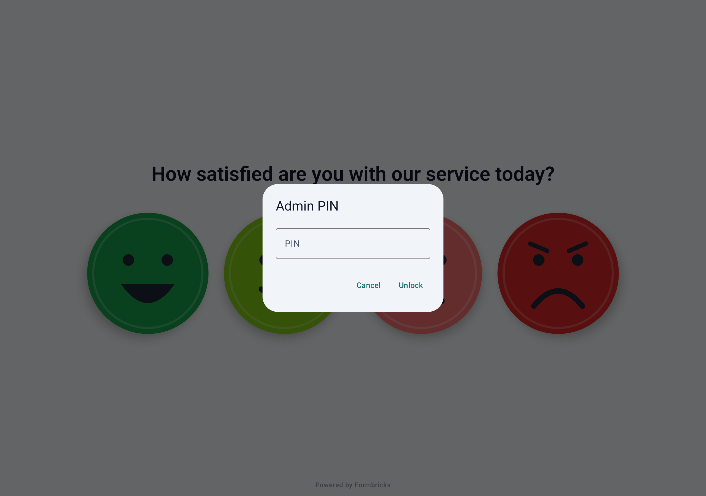
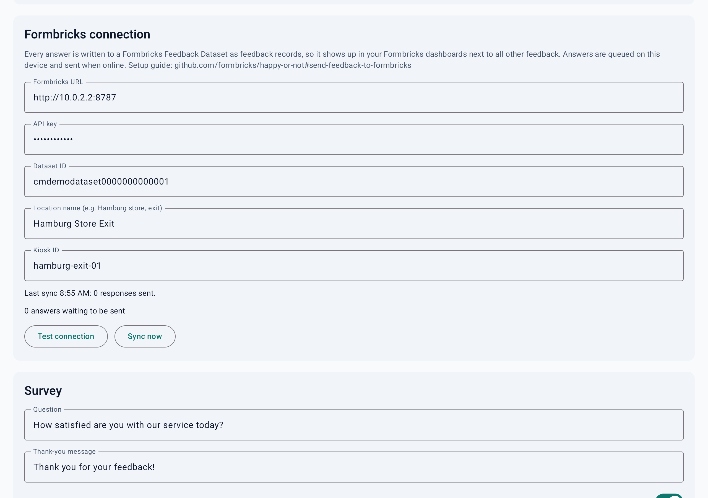

# Formbricks Kiosk

> [!WARNING]
> **This is not an officially supported part of the Formbricks offering.**
> Formbricks Kiosk is a community open-source project. It comes without support, SLAs or
> guaranteed maintenance, and it is updated only occasionally. Use it at your own risk, and test it
> before you rely on it. Issues and pull requests are welcome, but there's no promise they'll be
> answered quickly.

An open-source, one-tap feedback terminal for Android tablets. Put a tablet on a stand at a till,
exit, reception desk or restroom, ask one question, and collect answers on a four-point smiley
scale. Every answer flows straight into a [Formbricks](https://formbricks.com) Feedback Dataset, so
it shows up in your Formbricks dashboards next to all your other feedback.

| Survey | Follow-up |
| --- | --- |
|  |  |
| **Thank you** | **Admin: results** |
|  |  |
| **Admin: PIN** | **Admin: Formbricks connection** |
|  |  |

The screenshots come from the automated test run on an Android 14 tablet emulator, connected to a
test stand-in for Formbricks (hence the `10.0.2.2` URL).

**Contents:** [Features](#features) ·
[Setup manual](#setup-manual) ·
[Daily use](#daily-use) ·
[What arrives in Formbricks](#what-arrives-in-formbricks) ·
[Troubleshooting](#troubleshooting) ·
[For developers](#for-developers)

## Features

- **One-tap answers.** Four large drawn faces, from very happy to very unhappy.
- **Optional follow-up.** After a tap, ask "What was the main reason?" with up to nine answers you
  choose. It times out after 12 seconds if nobody answers.
- **Spam protection.** Taps are ignored while the follow-up and thank-you screens are showing.
- **Built into Formbricks.** Answers become Formbricks feedback records in the dataset you choose,
  tagged with the kiosk's location, ready for dashboards, filters and AI topics.
- **Works offline.** Every answer is saved on the tablet first and sent when the connection is back.
- **On-device results.** Today, all-time and 7-day breakdowns with a "% positive" score, plus a CSV
  export, even without Formbricks.
- **Kiosk mode.** Fullscreen, keeps the screen on, ignores the back gesture, and can pin itself to
  the screen.

## Setup manual

Setting up the first kiosk takes about 20 minutes. Steps 1–4 happen in Formbricks and are done once;
steps 5–9 happen on each tablet.

**You need:**

- An Android tablet with Android 8.0 or newer and Wi-Fi. A 10-inch screen works well.
- A stand or wall mount, and a power cable long enough to keep the tablet charging.
- A Formbricks organization with the **Unify Feedback** feature, and an **Owner** or **Manager**
  account in it (for steps 1–3).

### Step 1: Create a dataset in Formbricks, or pick an existing one

A dataset is the container the kiosk feedback lands in.

- **To keep kiosk feedback next to your other customer feedback** (surveys, reviews, support
  tickets), use your existing dataset. Kiosk answers are marked with the source type `kiosk`, so you
  can always filter them apart.
- **To keep it on its own** (for example, a separate "In-store feedback" program), create a new
  dataset: open **Settings → Organization → Datasets** and click **Create dataset**.

### Step 2: Give a workspace access to the dataset

API keys are granted per workspace, so the dataset needs a workspace the key can act on.

1. In **Settings → Organization → Datasets**, click **Manage** on the dataset.
2. Add the workspace whose dashboards should show the kiosk feedback.
3. Save.

A workspace can access only one dataset.

### Step 3: Create an API key for your kiosks

1. Open **API Keys** from the organization dropdown in the breadcrumbs.
2. Create a key named, for example, "Feedback kiosks".
3. Add the workspace from step 2 and give it **Write** access. Write is all the kiosk needs; don't
   give it Manage.
4. Copy the key and keep it somewhere safe for step 8. It's shown only once.

Use one key for all kiosks, kept just for them. The key is stored on each tablet, so if a tablet is
lost or stolen, delete the key in Formbricks and enter a new one on the remaining kiosks.

### Step 4: Copy the dataset ID

In **Settings → Organization → Datasets**, click **Manage** on the dataset. The **Dataset ID** is
shown at the bottom of the dialog; copy it. It looks like `cmabc123def456ghi789jkl0`.

On older Formbricks versions that don't show it there, ask an AI assistant connected to the
Formbricks MCP server to run `list_feedback_datasets` for your workspace, or ask your Formbricks
contact.

### Step 5: Install the app on the tablet

1. Connect the tablet to Wi-Fi.
2. On the tablet, open the browser and go to
   **[github.com/formbricks/happy-or-not/releases/latest](https://github.com/formbricks/happy-or-not/releases/latest)**.
3. Download **formbricks-kiosk.apk**.
4. Open the downloaded file. Android asks to allow installs from the browser: tap **Settings**, turn
   on **Allow from this source**, go back, and tap **Install**.
5. Open **Formbricks Kiosk**. The survey screen appears in fullscreen.

Managing many tablets with a device management (MDM) tool? Upload the same APK there instead.

### Step 6: Open the admin screen and change the PIN

1. Tap the **top-left corner of the screen five times** within 3 seconds.
2. Enter the PIN **1234** and tap **Unlock**.
3. Scroll to **Survey**, enter a new PIN of 4–8 digits under **Admin PIN**, and tap **Save
   settings** at the bottom.

Write the new PIN down: there's no way to reset it without reinstalling the app.

### Step 7: Set your question

Still in the admin screen, under **Survey**:

1. **Question**: what the four faces answer, e.g. *How was your visit today?*
2. **Thank-you message**: shown for 3 seconds after each answer.
3. **Ask a follow-up question**: on by default. Turn it off for a single-tap kiosk.
4. **Follow-up question** and **Follow-up answers**: the reasons people can pick, one per line, up
   to nine. Keep them short; they're shown as large buttons.
5. Tap **Save settings**.

### Step 8: Connect the tablet to Formbricks

Under **Formbricks connection**:

| Field | What to enter |
| --- | --- |
| Formbricks URL | `https://app.formbricks.com`, or the URL of your self-hosted Formbricks |
| API key | The key from step 3 |
| Dataset ID | The ID from step 4 |
| Location name | Where this tablet stands, e.g. `Hamburg store, exit`. It's how you'll tell kiosks apart in Formbricks. |
| Kiosk ID | Pre-filled with a random ID. Change it to something readable like `hamburg-exit-01` if you like. Give every tablet its own. |

1. Tap **Save settings**.
2. Tap **Test connection**. It should say *Connected: this kiosk can write to the dataset.* If it
   says something else, see [Troubleshooting](#troubleshooting).
3. Tap a face on the survey screen once as a test, wait 30 seconds, then check that the answer
   appears in Formbricks under **Analyze → Feedback Data**.

### Step 9: Lock the tablet to the app and put it out

1. In the tablet's Android **Settings**, search for **App pinning** (on some tablets it's called
   **Screen pinning**, under Security) and turn it on.
2. Back in the kiosk's admin screen, tap **Pin app to screen** and confirm. Now nobody can leave the
   app without your PIN-protected admin screen or the tablet's own unpin gesture.
3. In Android **Settings → Display**, set the screen timeout as long as possible. The app keeps the
   screen on while it's open.
4. Mount the tablet, plug in the charger, tap **Back to survey**, and you're done.

To set up the next tablet, repeat steps 5–9 with the same API key and dataset ID, and a different
location name and kiosk ID.

## Daily use

| Task | How |
| --- | --- |
| Open the admin screen | Tap the **top-left corner five times** within 3 seconds, then enter the PIN. |
| See today's results on the tablet | Admin screen → **Results** |
| Change the question or follow-up answers | Admin screen → **Survey** → **Save settings**. Only new answers carry the new question. |
| Send queued answers right away | Admin screen → **Formbricks connection** → **Sync now** |
| Export the answers stored on the tablet | Admin screen → **Export CSV** (opens the Android share sheet) |
| Leave kiosk mode | Admin screen → **Unpin** |
| After a power cut or restart | Open **Formbricks Kiosk** again. Answers not yet sent are kept. |

Answers are sent automatically about 20 seconds after they're given, so the follow-up answer
travels with the rating. If the tablet is offline, answers wait on the tablet and are retried every
30 seconds.

## What arrives in Formbricks

Each answer arrives as one submission with one or two feedback records:

| `field_id` | `field_type` | Value | Question text (`field_label`) |
| --- | --- | --- | --- |
| `satisfaction` | `rating` | `value_number`: 4 = very happy, 3 = happy, 2 = unhappy, 1 = very unhappy | Your kiosk question |
| `reason` | `categorical` | `value_text`: the follow-up answer picked (only if one was picked) | Your follow-up question |

Every record also carries:

| Member | Value |
| --- | --- |
| `source_type` | `kiosk` |
| `source_id` | The kiosk ID |
| `source_name` | The location name |
| `submission_id` | `<kiosk ID>-<answer number>`: links the rating and the reason of one answer |
| `collected_at` | When the face was tapped, not when it was sent |
| `metadata` | `kiosk_id`, `location`, `mood` (e.g. "Very happy"), `scale_max` (4), `app_version` |

Charts worth building on a Formbricks dashboard:

- **Satisfaction over time**: field `satisfaction`, average value, by day.
- **Kiosks compared**: the same chart, split by source name.
- **Why people are unhappy**: field `reason`, count by value, for submissions with a satisfaction
  of 1 or 2.

## Troubleshooting

The admin screen shows the result of the last sync and how many answers are waiting to be sent.
Nothing is lost while a setting is wrong: answers stay on the tablet until a sync succeeds.

| Message | Fix |
| --- | --- |
| *The API key is not valid.* | Re-enter the key, or create a new one (step 3). |
| *The API key has no access to this dataset.* | Check the dataset ID, and that the key has Write access to a workspace the dataset is assigned to (steps 2–4). |
| *This Formbricks instance doesn't offer the Feedback Records API.* | Check the URL. Self-hosted instances need Unify Feedback and the Feedback Records API gateway enabled. |
| *Can't reach Formbricks* | The tablet is offline. Answers are sent once it's back online. |
| *Save settings to use the changes.* | You edited a field but haven't saved yet. |
| The PIN is lost | Uninstall and reinstall the app. This also deletes answers not yet sent. |

## For developers

### Building

Requirements: JDK 17 and the Android SDK (API 35). Android Studio provides both.

```bash
./gradlew assembleDebug
```

The APK is written to `app/build/outputs/apk/debug/app-debug.apk`.

To install it on a connected device or a running emulator, click through the whole flow, and check
what reaches a mock of the Formbricks API (screenshots, a recording and the received records land in
`demo-output/`):

```bash
scripts/emulator-demo.sh app/build/outputs/apk/debug/app-debug.apk
```

Debug builds accept the Formbricks connection as launch extras:

```bash
adb shell "am start -n com.formbricks.kiosk/.MainActivity --es fb_host https://app.formbricks.com --es fb_api_key <key> --es fb_dataset_id <datasetId> --es fb_location 'Test bench'"
```

### CI, releases and online demo

`.github/workflows/android.yml` runs on every push:

1. **build**: builds the APK (artifact `formbricks-kiosk-apk`).
2. **emulator-demo**: boots an Android 14 tablet emulator, starts a mock of the Formbricks Feedback
   Records API (`scripts/mock-formbricks.py`), clicks through the kiosk, syncs, and fails unless
   the expected feedback records arrive. Screenshots, a recording and the received records are
   uploaded as the `emulator-demo` artifact and published to the `ci-demo` branch.
3. **release**: on a version tag such as `v0.1.0`, publishes a GitHub release with
   `formbricks-kiosk.apk` attached. That's the download link in step 5 of the manual.
4. **appetize** (optional): uploads the APK to [Appetize.io](https://appetize.io) so anyone can try
   the app in a browser. Add an `APPETIZE_API_TOKEN` repository secret to turn it on, and an
   `APPETIZE_PUBLIC_KEY` repository variable to keep updating the same link. The link appears in the
   workflow run summary.

To refresh the README screenshots, copy the PNGs from the latest run on the `ci-demo` branch
(`runs/<branch>/`) into `docs/screenshots/`.

### Project layout

```
app/src/main/java/com/formbricks/kiosk/
  MainActivity.kt          fullscreen, keep-screen-on activity
  KioskViewModel.kt        survey flow, timers, admin unlock, sync loop
  data/Settings.kt         operator settings (SharedPreferences)
  data/ResponseDb.kt       local answer store, stats, CSV
  data/FormbricksClient.kt Formbricks Feedback Records API client
  ui/Faces.kt              the drawn smiley faces and buttons
  ui/KioskApp.kt           survey, follow-up, thank-you and PIN screens
  ui/AdminScreen.kt        results, Formbricks connection, settings and actions
scripts/
  emulator-demo.sh         drives the app on an emulator and checks the records sent
  mock-formbricks.py       mock of the Feedback Records API for CI
docs/screenshots/          screenshots used in this README
```

## License

MIT. See [LICENSE](LICENSE).
